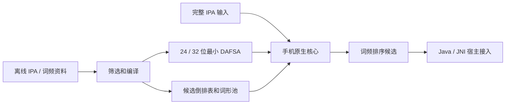

# 中英日 IPA 图词典引擎

## v0.0.2-dev 顺序省略升级

当前默认匹配允许从完整词典IPA中删除任意符号，剩余符号须与完整输入依序一致；不替换、换序或丢弃已输入字符。支持漏音段、声调、重音、长音、附加符、分节与空格。输入先NFC，比较时对IPA预组字符作规范分解，原始词典路径仍用于展示和候选定位。数字1–5对应˩˨˧˦˥，是音高值而非普通话声调类别。`maɪ`召回my，`nixɑʊ`与`ni35 xɑʊ̯21`召回你好；完整精确命中后仍继续省略搜索，不遮蔽其他合法候选。

在原24位DAFSA上进行有界优先队列遍历，状态保存图节点、完整路径的词典序编号、输入进度与遗漏量；共享后缀的不同前缀不会因节点去重而丢失候选表。优先扩展较少音段/注记遗漏的路径，并使用后缀最大深度和保守符号Bloom摘要剪枝。摘要碰撞只会减少剪枝，不会排除合法候选。后缀辅助数组约每节点9字节，完整图约10.29MB原生内存；词典文件字节不变。

默认省略预算20,000个创建状态，最多200,000；仍最多180候选、原生预算最多60ms。候选上限、状态/前缀预算或截止导致截断时报告truncated；宽松截止若已有结果，则保留结果并返回ok。严格模式仍可用CLI `--strict` 或Java六参数Options中的allowOmissions=false。完整匹配基分10000，省略匹配5000减每漏符号20，显式前缀补全1000，再加词频并减派生罚分5。Candidate.omittedSymbols与QueryResult.exploredStates用于观察。显式补全先按prefixKeyBudget运行，省略阶段不会绕过该补全预算。

数学上的完整子序列匹配集合随输入删除而扩大，但有限候选与运行预算下可见列表不保证包含全部合法词或单调扩大。该版完整AAR及版本信息保存在 Git 历史的 `remote/pre-release/v0.0.2-dev/`，桌面正确性报告为 `data/reports/graph-omission-upgrade.json`；新版没有复测手机性能。下文的S21与v0.0.1-dev数字均为旧严格查询历史，不能视为新版省略模式指标。

v0.0.3-dev 已把默认查询核心、C ABI、原生 CLI 与图最小化器迁移到 Rust，Java/JNI 薄层保持接口兼容。旧 C++ 实现只用于迁移对照，源码及合成测试同步到公开 `remote/source/`。未处理的原始数据和 SQLite 资料库留在本地。严格/省略各5,000条来源用例与旧实现逐字段对照零差异。开发机交替3轮各500输入，默认省略p95中位数从4.9526 ms降至3.8534 ms；一次加载从44.32 ms变为54.74 ms。搜索状态24 B，图摘要仍9 B/节点；仅在接受键命中时按路径编号重建IPA。报告在 `data/reports/rust-migration.json`，不是手机性能。

当前实现把资料库离线编译为一个最小确定无环接受器（DAFSA / 词典 DAWG），以完整 IPA 路径的词典序编号定位多候选表。手机只映射紧凑二进制词典；不加载 SQLite、Python、PyTorch 或 OpenFst。当前排序依据词形词频，无上下文。通用模型训练工具保留，旧权重已删除。

当前整数评分为：完整匹配基分10,000，省略匹配5,000减每漏符号20，显式补全基分1,000，加 `frequencyScore`（Zipf × 20），派生读音减 5。同分按词形确定排序；同一输出跨地区去重并合并标签，诊断中的地区/派生/匹配 IPA 对应胜出的记录。缺少词频时参考分为 0；源频率缺失信息仍保留在离线资料中。

| 项目 | 24 位默认 | 32 位对照 |
| --- | ---: | ---: |
| 编译词典 | 28,986,769 B（28.99 MB） | 34,213,887 B（34.21 MB） |
| v0.0.1-dev 完整 Android AAR（历史） | 29,239,937 B | 34,467,346 B |
| 边记录 | 1 B 标签 + 3 B 目标 | 1 B 标签 + 4 B 目标 |
| 输入键 / 词形 / 地区映射 | 1,024,289 / 768,387 / 1,281,101 | 完全相同 |

MB 为十进制。32 位同时扩展节点起点、路径计数、候选起点、词形块起点和边目标，体积增加 18.03%。默认 24 位没有为了控制体积裁剪可收录词条。候选频率以 0.05 Zipf 为步长量化，这项评分有损与图关系无损分别验证。完整筛选、来源和校验值在 `data/compiled/lexicon.manifest.json` 中。

最小图含 1,143,559 个节点、1,867,683 条边；相同键集的普通 Trie 需 5,289,813 个节点。词形池每 16 词重启一次 UTF-8 前缀压缩，候选使用差分词形编号、varint、地区/派生位和单字节分数。具体取舍见 [图结构选型](图结构选型.md)，字节布局见 [格式说明](../graph/format_spec.md)。尚未以本词集实测 MARISA、双数组 Trie 或 CompactFst，因此不把本实现称作所有实现中绝对最小的格式。



## 编译与构建

在项目根目录运行。离线编译器读取已有 `data/ipa.sqlite`，手机宿主只使用产物。

```sh
# 默认完整词典，超预算则失败；不会静默削减词条。
python3 scripts/compile_graph_dictionary.py

# 直接编译独立的全 32 位对照词典，默认允许至 40 MB。
python3 scripts/compile_graph_dictionary.py --index-bits 32

# 已有完整 24 位词典也可直接转换，候选/词形数据不变。
python3 scripts/convert_graph_indices.py \
  --source data/compiled/lexicon.ipad \
  --output data/compiled/lexicon-32.ipad --index-bits 32

# 完整依赖包与可在 adb shell 调用的原生 CLI。
python3 scripts/build_android_library.py --output-dir data/android/24
python3 scripts/build_android_library.py \
  --dictionary data/compiled/lexicon-32.ipad \
  --manifest data/compiled/lexicon-32.manifest.json \
  --output-dir data/android/32
```

编译图需 Python 3 和 Rust 1.89+；Rust 最小化器输出与旧 C++ 参照一致，Android 构建还需 JDK、SDK platform jar、NDK；脚本支持 `--ndk`、`--sdk` 等显式路径。当前实际使用 NDK r30，目标 Android API 26+、`arm64-v8a`，共享库支持 16 KiB 页对齐。`--core-only` 可输出不含资产的核心 AAR，由宿主自行提供词典；核心包体积以对应构建报告为准，与同版完整包的 Java/JNI 代码逐字节一致。词典编译报告和运行报告被跟踪，巨型资料、工具安装和二进制产物被 Git 忽略。

## 在终端观察输入和候选

`scripts/engine_cli.py` 调用与 Android 同源的 Rust 图核心。首次运行自动构建桌面程序；它不在查询时使用 SQLite。输出显示状态、耗时、精确命中、扫描量、截断，以及候选文字、地区、参考词频、类型、来源属性和实际匹配 IPA。

```sh
python3 scripts/engine_cli.py query 'həˈloʊ' --region en-US
python3 scripts/engine_cli.py query 'tu' --region en-US
python3 scripts/engine_cli.py query 'ni˨˩˦ xɑʊ̯˨˩˦' --region zh-CN
python3 scripts/engine_cli.py query 'ɡakːoɯ' --region ja-JP
python3 scripts/engine_cli.py query 'hə' --prefix --limit 10
python3 scripts/engine_cli.py query 'həˈloʊ' --json
python3 scripts/engine_cli.py repl
python3 scripts/engine_cli.py test
python3 scripts/engine_cli.py reverse 'hello' --region en-US
python3 scripts/engine_cli.py reverse '学校' --json
python3 scripts/engine_cli.py info
python3 scripts/engine_cli.py bench 'həˈloʊ' --iterations 10000
```

例如 `tu` 在 `en-US` 精确查到 `too` 和 `two`，按词频排；`tuː` 是另一完整键，不能假定英美来源的长度标记完全相同。严格模式保留声调、英语重音、长音、音节界限和内部空格，Python/Java 入口只做 NFC。直接使用 Rust/C API 时调用方应提供 NFC 输入。

交互模式输入 `test` 随机展示一条用例的输入、配置、预期、实际候选和断言结果；默认使用 `tests/cases/graph_cases.jsonl`，可用 `repl --cases PATH` 指定其他 JSONL。用例自己的地区、补全和候选上限生效，不套用当前交互查询配置。

直接输入词汇时，若没有正向 IPA 命中或补全，自动反查词典收录的 IPA。`reverse 词汇` 强制反查，`ipa 输入` 强制正向查询并展示无匹配诊断；这也解决词汇本身是完整 IPA 键或 `test` 命令的歧义。不存在的词汇没有输出，JSON 模式同样不输出空记录。反查按 NFC 后的精确词形匹配，保留全部 IPA/地区关系，可用 `--region` 筛选，不改变大小写或简繁。

反查使用桌面工具 `graph/lexicon_reader.py` 只读映射所选编译词典：二分搜索前缀压缩词形池，找到词形后扫描候选表，仅重建匹配 IPA 路径。它不使用资料库，也不把整个词典展开到内存；扫描成本高于正向图查询。Android 核心、词典格式和既有 AAR 没有新增这一桌面功能。

## 用例、完整性与宽度比较

```sh
python3 scripts/engine_cli.py cases tests/cases/graph_cases.jsonl \
  --output data/reports/graph-cases.json

# 从五地区分别抽取 1000 个可收录来源观测，建立可复现参考集。
python3 scripts/engine_cli.py sample-cases --per-region 1000 --seed 42
python3 scripts/engine_cli.py cases data/compiled/source-cases.jsonl \
  --output data/compiled/source-cases-results.json

# 相同输入、地区、候选上限和前缀设置比较两种格式的完整结果。
python3 scripts/engine_cli.py compare data/compiled/lexicon-32.ipad

# 独立读取格式、路径编号、候选与词形池的参照验证和交替基准。
python3 graph/tests/compare_formats.py --help
```

用例为 JSONL，每行例如：

```json
{"id":"us-homophones","raw":"tu","regions":["en-US"],"limit":180,"expected_all":["too","two"]}
```

可设置 `prefix`、`prefix_budget`，断言 `expected_any`、`expected_all`、`expected_empty`、`expected_nonempty`、`expected_status`、`expected_truncated`。`cases --verbose` 可逐条显示输入输出。源数据参考集验证的是候选映射保留，不能作为语言学读音准确率或首选准确率。

目前已通过 14 个人工边界用例、五地区共 5,000 条来源观测的期望候选检查、两格式 5,000 个独立抽取键的完整候选参照比较，以及全量 `24 → 32 → 24` 字节一致验证。编译器、运行时、损坏文件、Unicode、并发和 JNI 的自动测试见 `tests/`、`graph/tests/`、`android/tests/`。

开发机 5 轮、每轮每格式对 5,000 个输入循环查询 100,000 次，24/32 位 p95 中位数分别为 0.001916/0.002250 ms；加载约 33.385/32.242 ms。这个报告含预热，未控制系统页缓存，也不包含 Java 或宿主调度。

## S21 Ultra 与 Android 接入（v0.0.1-dev 历史）

已在 **SM-G998U1 / Android 15 / API 35** 实测，两格式的 5,014 个输入用例输出完全一致，每格式 5 轮共 500,000 次查询，无错误或超时。各轮先后顺序交替；数据集为五地区 5,000 个源数据输入，查询为全地区精确模式、上限 180 候选。

| 手机原生核心指标 | 24 位 | 32 位 |
| --- | ---: | ---: |
| p50（各轮中位数） | 0.002761 ms | 0.002865 ms |
| p95（各轮中位数） | 0.006979 ms | 0.007292 ms |
| p99（各轮中位数） | 0.030781 ms | 0.031562 ms |
| 加载/验证（各轮中位数） | 70.376 ms | 67.806 ms |
| 抽样峰值进程 RSS | 35,260 KiB | 40,328 KiB |

**用户已确认正式采用 24 位，停止追加测试。** 32 位加载稍快，但查询没有显著改善，并增加 5.23 MB 词典和约 5 MiB 观测 RSS。文件缓存没有强制清空，RSS 为 50 ms 抽样、包括已驻留的映射页且可能漏掉短暂峰值；不能把这些指标视为冷磁盘或精确内存上界。完整报告为 `data/reports/graph-s21-comparison.json`，逐输入输出另存 `data/compiled/android-native-cases.json`。

实际 24 位 AAR 的 **17 项手机检查通过**，覆盖 Java/JNI、Android JSON、词典资产提取/SHA、缓存复用/损坏修复、五地区查询、生命周期、完整包装基准和持续测试。最近一轮首次 `openBundled` 263.523 ms，缓存初始化 149.458 ms；包含资产与 SHA 开销，发生于初始化。

完整 Java/JNI `queryDetailed` 在 5,000 个五地区交替输入上执行 10,000 次，p50 **0.046615 ms**、p95 **0.286407 ms**、p99 **1.783125 ms**，最大 6.427 ms；全部有候选，无不支持/错误/超时。它包含 NFC、JNI、原生 JSON、Android JSON 和候选对象构造，仍不包含键盘 UI 或服务调度。

3 分钟、每秒 10 次的持续测试实际执行 **1800 次**，全部成功；p95 3.500 ms、p99 19.387 ms、最大 40.957 ms。原生已分配堆从 7,320,048 B 到 7,320,096 B。整体进程 PSS 从 52,722 到 66,202 KiB，Java 已用堆从 5,011,408 到 19,171,280 B；未强制 GC，不能仅凭这段增长判定泄漏或宣称长期稳定。低频持续输入的延迟明显高于紧密循环基准，也需保留这一实际结果。

报告为 `data/reports/android-wrapper-probe.json`。这些是独立测试 APK 的结果，15–30 分钟真实键盘/服务生命周期与耗电仍由宿主场景验收。

32 位 AAR 也已在同一手机完成 16 项包装检查和 10,000 次完整查询。其单轮 p50/p95/p99 为 0.042240/0.232917/1.520729 ms，全部有候选、无错误/超时。该轮 Java 堆从 15,332,624 B 增至 94,303,504 B，而 24 位那轮发生了回收；两轮的 GC 条件不同。这一单轮差异不单独作为位宽收益结论。报告为 `data/reports/android-wrapper-probe-32.json`，用户已决定采用 24 位并停止追加测试，未继续重复包装对比。

两个 AAR 分别在 `data/android/24/ipa-graph-full.aar` 与 `data/android/32/ipa-graph-full.aar`。Java 接入入口为 `com.ipaengine.graph.GraphEngine.openBundled(context)`；首次将资产按 SHA-256 命名复制到宿主私有目录，核验后只读映射。每个查询的候选列表不可变，关闭与查询串行保护。配置、代码例和宿主转换见 [Android 说明](../android/README.md)。

设备测试工具分别验证原生核心与实际 AAR 包装：

```sh
python3 scripts/test_android_device.py --serial R5CR10YXLJB
python3 scripts/test_android_wrapper.py --adb --serial R5CR10YXLJB
# 可选 15 分钟、每秒 10 次查询与每 5 秒内存采样；默认不执行。
python3 scripts/test_android_wrapper.py --adb --serial R5CR10YXLJB \
  --soak-seconds 900 --query-rate 10
```

包装工具默认另用固定五地区 5,000 个输入做预热 1,000 次、查询 10,000 次的整体基准，计时包含 NFC、JNI、原生 JSON、Android JSON 解析和候选对象，独立报告 PSS、原生/Java 堆。持续测试参数默认关闭，不强制 GC，测试用例只进入 probe APK。

前者推送词典和命令行程序到 `/data/local/tmp/ipa-graph-test`，校验哈希、比较候选、交替基准并记录设备信息。后者构建和安装独立测试 APK `com.ipaengine.graph.probe`，实际调用 AAR 的 Java/JNI、Android JSON、资产提取、缓存、损坏缓存修复和生命周期；它没有键盘界面。测试后可用 `adb uninstall com.ipaengine.graph.probe` 移除测试应用。

依赖库不包含 IPA Board 宿主工程。宿主仍须接入 IPA 路由、地区开关、分段表达式、Messenger 请求标识/候选数组、固定故障码与进程隔离，依照 [接口规范](引擎开发规范.md)。真实输入法 UI 调度、提交语义与持续使用耗电不能由裸核心基准代替。

## 当前边界与后续模型

默认完整匹配加顺序省略；可显式关闭省略对照严格模式。显式前缀补全默认最多访问 2,048 个键，并报告 `truncated`。截断时结果只在已访问范围内按词频排序，不能承诺全部扩展中的全局最高频候选。每次查询消费全部 raw，不丢弃未知后缀；不支持的输入、无匹配与空预测返回空候选，最多 180 项。

尚未实现任意连续 IPA 的分词拼接、模糊发音纠错或上下文预测。下一步可在输入位置间建立词典匹配的带权 DAG，再验证切词和拼接策略；需要错误图或语言模型组合时重新衡量 WFST/OpenFst。

`ipa_model/`、`model_runtime/`、`requirements-training.txt`、可复用训练语料及训练、导出、评估程序保留，使用方式见 [模型训练工具](模型训练工具.md)。旧权重未证明首选排序有稳定收益，已删除。未来应对已生成候选做条件评分，校准与词频的组合，并测同音词重排首选命中率；模型缺字不能导致字典候选被删除。

来源许可与逐来源记录随编译 manifest 保留。当前完整包用于本地研究验证，产品分发范围须依实际采用来源确定，不能把混合词典统一视作一种许可证。
